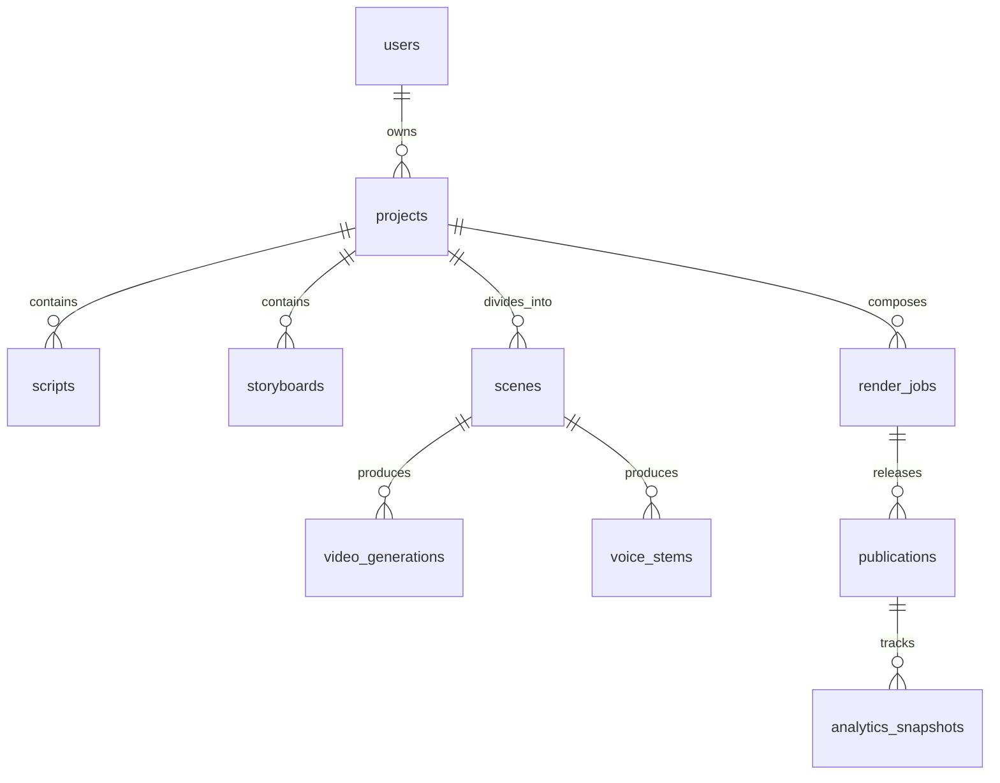

# PostgreSQL Database Architecture & Schema Specification

## 1. Overview
The database architecture for Sir's AI YouTube Agentic Studio is defined via Drizzle ORM across 12 domain schemas, comprising 59 normalized tables in PostgreSQL 16.

---

## 2. Domain Schema Breakdown

### 2.1 Auth & Tenancy (`lib/db/schema/auth.ts`)
- `users`: Core user entity (Email, hashed password, role, 2FA secret, status).
- `sessions`: Ephemeral JWT tracking sessions with device fingerprinting.
- `api_keys`: Encrypted external API credentials (AES-256-GCM ciphertext).
- `audit_logs`: Immutable security log of mutations, user logins, and kill switch activations.

### 2.2 Projects & Pre-Production (`lib/db/schema/projects.ts`)
- `projects`: Master project records (Title, format: 9:16 vs 16:9, genre, status).
- `scripts`: Screenplays, natural Telugu dialogue lines, emotional pacing notes.
- `storyboards`: Cinematic scene breakdown, shot types, camera angles, color grading.
- `characters`: Character Bible entity (Face references, costume, age, voice ID).

### 2.3 Generation & Media Assets (`lib/db/schema/generation.ts` & `media.ts`)
- `scenes`: Individual scenes with timing, prompt, and dialogue.
- `video_generations`: Gemini Veo generation jobs, seed, prompt, motion vector, URL.
- `voice_stems`: Emotive Telugu TTS audio files, duration, pitch, sample rate.
- `music_tracks`: Background score selections, mood tags, license attribution.
- `media_assets`: Uploaded reference images, B-roll, custom audio clips.

### 2.4 Rendering, Publishing & Operations (`lib/db/schema/rendering.ts` & `publishing.ts`)
- `render_jobs`: Multi-track FFmpeg assembly jobs, progress, output URL.
- `quality_checks`: Automated QC reports (Loudness LUFS, subtitle alignment, copyright).
- `channels`: Connected YouTube and Instagram professional accounts (encrypted tokens).
- `publications`: Scheduled and live video releases, YouTube video ID, Instagram Reel ID.
- `publishing_slots`: Optimized time slots in Asia/Kolkata timezone.

### 2.5 Analytics & Intelligence (`lib/db/schema/analytics.ts` & `automation.ts`)
- `analytics_snapshots`: Time-series views, watch hours, RPM, subscriber conversions.
- `retention_curves`: Second-by-second audience retention points.
- `thumbnail_experiments`: Live A/B testing variants, CTR, impressions, statistical winner.
- `automations`: Cron and event-driven automation rules.

