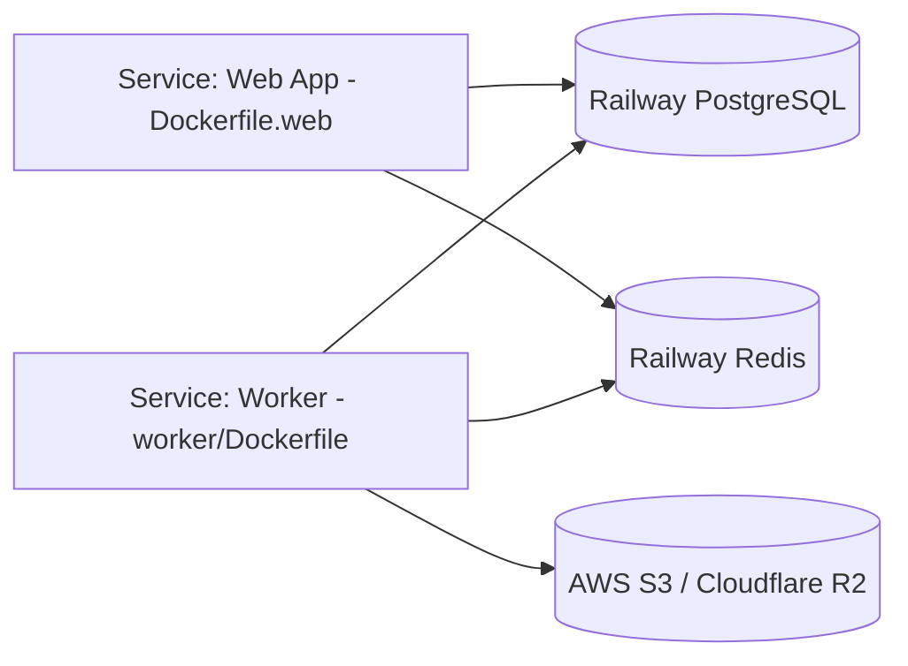

# Railway Production Deployment Guide

## 1. Prerequisites
- A Railway account connected via Railway CLI or GitHub repository link.
- Provisioned Railway PostgreSQL instance (`DATABASE_URL`).
- Provisioned Railway Redis instance (`REDIS_URL`).
- S3 / Cloudflare R2 bucket credentials (`S3_BUCKET_NAME`, `S3_ACCESS_KEY`, `S3_SECRET_KEY`).
- Google Gemini API Key (`GEMINI_API_KEY`).
- Google Cloud OAuth 2.0 Credentials for YouTube (`YOUTUBE_CLIENT_ID`, `YOUTUBE_CLIENT_SECRET`).

---

## 2. Multi-Service Railway Topology



---

## 3. Environment Variables Configuration

Configure the following environment variables in your Railway Project dashboard:

```env
# Application Runtime
NODE_ENV=production
NEXT_TELEMETRY_DISABLED=1
PORT=3000
NEXT_PUBLIC_APP_URL=https://sir-youtube-studio.up.railway.app
NEXT_PUBLIC_MOCK_MODE=false

# Security & Secrets
JWT_SECRET=generate_strong_64_character_hex_secret_here
TOKEN_ENCRYPTION_KEY=generate_strong_32_character_aes_key_here

# Database & Cache
DATABASE_URL=${{Postgres.DATABASE_URL}}
REDIS_URL=${{Redis.REDIS_URL}}

# Google Gemini API
GEMINI_API_KEY=AIzaSy...

# YouTube Data API v3
YOUTUBE_CLIENT_ID=...apps.googleusercontent.com
YOUTUBE_CLIENT_SECRET=GOCSPX-...
YOUTUBE_REDIRECT_URI=https://sir-youtube-studio.up.railway.app/api/auth/youtube/callback

# Meta Instagram Graph API
META_APP_ID=...
META_APP_SECRET=...
META_REDIRECT_URI=https://sir-youtube-studio.up.railway.app/api/auth/instagram/callback

# Object Storage
S3_ENDPOINT=https://<account-id>.r2.cloudflarestorage.com
S3_REGION=auto
S3_BUCKET_NAME=sirs-telugu-studio-assets
S3_ACCESS_KEY_ID=...
S3_SECRET_ACCESS_KEY=...
```

---

## 4. Database Migrations

Apply database migrations to Railway PostgreSQL:
```bash
npx drizzle-kit migrate
```
All 59 tables will be initialized with strict foreign keys and index constraints.

---

## 5. Build & Deploy Commands

### Web Service:
- **Build Command**: `yarn build`
- **Start Command**: `node server.js`
- **Healthcheck Path**: `/api/health`

### Background Worker Service:
- **Build Command**: Uses `worker/Dockerfile` with native FFmpeg and Telugu fonts (`fonts-lohit-telu`, `fonts-deva`).
- **Start Command**: `npx ts-node worker/index.ts`

