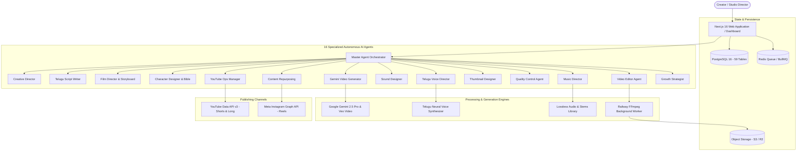

# Sir's AI YouTube Agentic Studio — System Architecture

## 1. Executive Summary
Sir's AI YouTube Agentic Studio is a production-grade, multi-agent AI operations and video production platform engineered specifically for regional Telugu visual storytelling, automated YouTube channel operations, and cross-platform publishing (YouTube Shorts, YouTube Long-form, Instagram Reels).

The system accepts a raw idea, dialogue, voice memo, or screenplay concept, and coordinates 16 specialized autonomous AI agents to orchestrate pre-production, generation, post-production, quality control, and scheduled distribution into peak audience attention windows in the Asia/Kolkata timezone.

---

## 2. High-Level Architecture Topology

---

## 3. Core Subsystems

### 3.1 Next.js 16 App Router & Design System
- Built on Next.js 16, React 19, and Tailwind CSS v4.
- Brand Theme: `#000000` (Deep Black), `#830000` (Blood Velvet), `#BC0202` (Crimson), `#FF0000` (Electric Red), and `#FFFFFF` (Stark White).
- Dedicated typography: Modern Sans paired with Telugu Unicode typography.
- Strict token-driven UI (`bg-card`, `text-muted-foreground`, `border-border`, `text-primary`).

### 3.2 Master Agent Orchestration Engine
- Centralized finite state machine managing asynchronous DAG task handoffs.
- Enforces artifact validation between agent phases.
- Supports individual scene regeneration without invalidating unchanged scenes.
- Resilient retry policies with exponential backoff and error recovery.

### 3.3 Audio Engineering & Telugu Voice Pipeline
- Separate dialogue synthesis from video generation to ensure broadcast-quality voice clarity.
- Pronunciation dictionary for authentic Telugu names, rural idioms, and compound words.
- Sidechain ducking compression: Background music automatically ducks by -14 dB whenever dialogue stems are active.
- EBU R128 loudness normalization targeting -14 LUFS for YouTube standards.

### 3.4 Video Rendering & Background Worker
- Dedicated headless Railway Docker service with native FFmpeg, `libx264`, and Indic fonts (`fonts-lohit-telu`, `fonts-deva`).
- Hardware-accelerated multi-track composition with frame-accurate Telugu Unicode subtitle burning.

